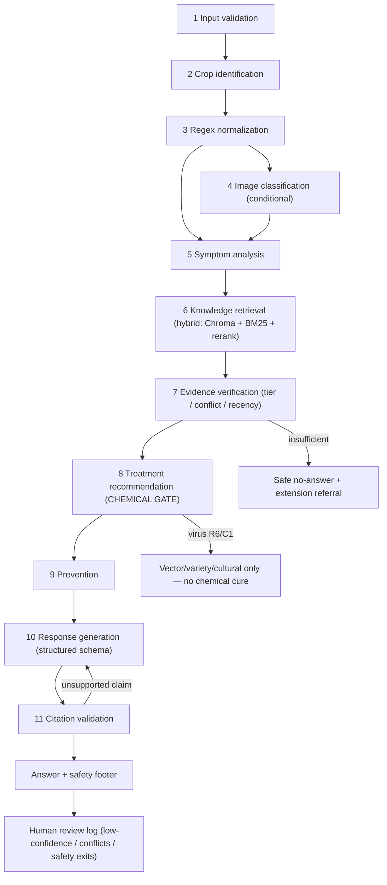

# Week 1 — Architecture

**Scope:** the *research‑and‑quality* subsystem built in Phase 1. The full assistant
(agents, RAG, image model, API, UI) is **planned**, not built yet — it is described
at the end so planned and implemented parts are never confused.

## 1. What Week 1 actually implements

Week 1 is the **evidence‑governance foundation**: a validated source register plus
the automation that keeps it honest. Nothing in Week 1 answers crop‑disease
questions yet.

| Component | Responsibility | Status |
|-----------|----------------|--------|
| `knowledge/source_register.csv` | Canonical ledger of every research source (17 columns) | ✅ implemented |
| `scripts/validate_source_register.py` | Structural + consistency validation of the register | ✅ implemented |
| `tests/test_source_register.py` | Unit tests proving the validator catches bad data | ✅ implemented |
| `.github/workflows/week-1-ci.yml` | Runs validator + pytest + ruff on push/PR | ✅ implemented |
| `pyproject.toml`, `requirements-dev.txt` | Pinned dev tooling (pytest, ruff, py311) | ✅ implemented |

## 2. Data flow (implemented)

**Validation rules enforced:** 17 required columns · non‑empty `source_id` · unique
`source_id` · no duplicate DOI URL · required fields populated · `tier ∈ {T1,T2,T3,T4}`
· `verification_status ∈ {pending,in_review,verified,rejected}` · expected row count.

## 3. Trust boundary (why this exists)

The register is the project's **single source of truth for evidence**. Every later
answer must trace back to a row here. Week 1 deliberately separates *"the CSV is
well‑formed"* (machine‑checkable, done by CI) from *"the paper is real and reusable"*
(human review, still pending). The validator never claims the latter.

## 4. Planned full‑system architecture (NOT built in Week 1)

From the internship PDF §10–§11. Shown so the Week‑1 foundation is seen in context;
every node below is **planned / future work**.

**Planned vs implemented summary**

| Layer | Planned (PDF) | Implemented in Week 1 |
|-------|---------------|-----------------------|
| Evidence register | ✔ | ✅ yes |
| CI / tests / lint | ✔ | ✅ yes |
| Ingestion + OCR (PyMuPDF/Tesseract) | ✔ | ❌ not yet |
| Knowledge cards (18) + schema validator | ✔ | ❌ not yet |
| Regex normalization engine | ✔ | ❌ not yet |
| Retrieval (ChromaDB + rank‑bm25 + reranker) | ✔ | ❌ not yet |
| LangGraph agent graph (nodes 1–11 + review log) | ✔ | ❌ not yet |
| Image classifier (EfficientNet/ConvNeXt, conditional) | ✔ | ❌ not yet |
| FastAPI backend + Streamlit UI + Docker | ✔ | ❌ not yet |

> The local folders `app/`, `ingestion/`, `eval/`, `ui/`, `data/`, `knowledge/cards/`
> seen in the working copy are **scaffolding placeholders** for the planned
> components above; they are not committed to the repository and contain no
> implemented logic yet.
