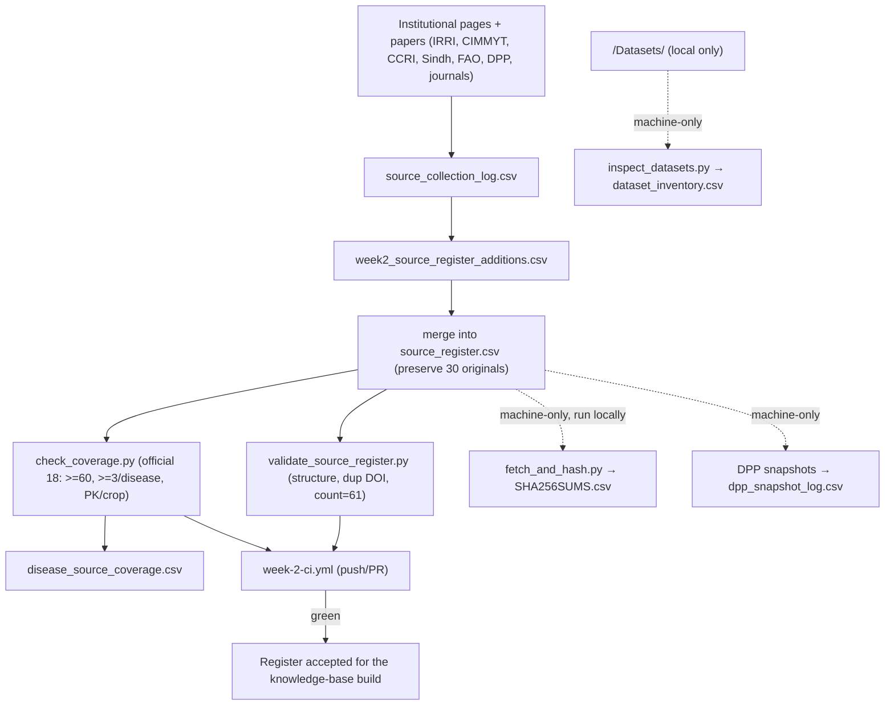
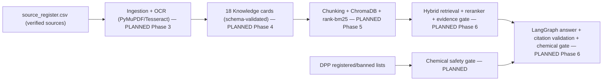

# Week 2 — Architecture

**Scope:** the *source‑collection & verification* pipeline built in Phase 2, and how
its output feeds the **planned** RAG knowledge base. Planned components are marked as
such — none of the retrieval/agent code exists yet.

## 1. What Week 2 actually implements

Week 2 turns scattered institutional pages and papers into a **validated, coverage‑
checked source register** for the official 18 diseases, plus the tooling to finish the
machine‑only steps locally.

| Component | Responsibility | Status |
|-----------|----------------|--------|
| `source_collection_log.csv` | Raw T1 leads captured during collection (Day 6–7) | ✅ implemented |
| `week2_source_register_additions.csv` | Week‑2 additions before merge | ✅ implemented |
| `week-1/knowledge/source_register.csv` | Canonical merged register (61 rows) | ✅ implemented |
| `scripts/check_coverage.py` | Maps rows → official 18; enforces ≥60, ≥3/disease, PK per crop | ✅ implemented |
| `reports/disease_source_coverage.csv` | Generated coverage matrix | ✅ implemented |
| `datasets/inspect_datasets.py` | Measures real image counts locally (Day 9) | ✅ implemented |
| `fetch_and_hash.py` + `hashes/SHA256SUMS.csv` | Download + hash permitted docs locally | ✅ tool ready (run locally) |
| `dpp_snapshot_log.csv` | DPP registered/banned list URLs to snapshot | ✅ log ready (capture locally) |
| `.github/workflows/week-2-ci.yml` | Validator + coverage gate + ruff on push/PR | ✅ implemented |

## 2. Data flow (implemented)

## 3. Disease‑ID mapping (the core logic)

The 30 original rows store disease **names**; Week‑2 rows store official **IDs**.
`check_coverage.py` reconciles both onto `R1–R6 / W1–W6 / C1–C6`, so coverage is
measured against the PDF's exact 18 diseases — never against dataset classes.
7 original rows map to **no** official disease (Fusarium Head Blight, Septoria, cotton
Fusarium/Verticillium Wilt, Alternaria) and are retained as extra, non‑counting sources.

## 4. How Week‑2 output feeds the planned system (NOT built yet)

Each future answer must cite a `source_id` from this register, and every chemical
claim must pass the DPP gate — which is exactly why Week 2 collects and verifies
sources and records the DPP list URLs now.

**Planned vs implemented:** everything in §4 (ingestion, cards, indexing, RAG, agent,
chemical gate) is **planned** for Phases 3–6; Week 2 implements only §1–§3.
