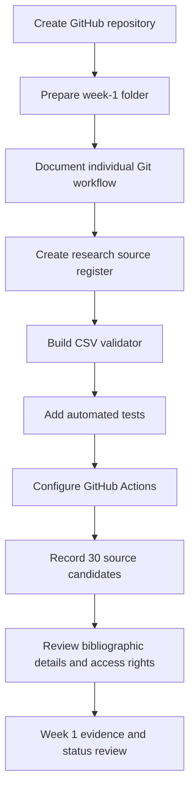
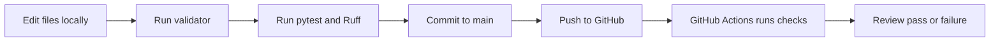
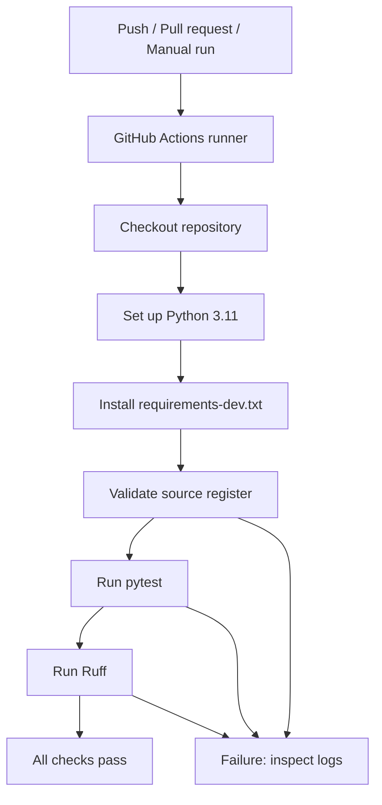

# IT Simplera Crop Disease Assistant | Week 1

<p align="center">
  
  
  <a href="https://github.com/Muhammad-Ali5/ITSimplera-internship/actions/workflows/week-1-ci.yml">
    
  </a>
</p>

> **Scope of this document:** This README records the Week 1 foundation only. It does not describe or change Week 2, Week 3, Week 4, or later implementation work.

Week 1 establishes the repository, an individual Git workflow, the initial project structure, research-source tracking, automated validation, tests, and GitHub Actions.

---

## 1. Project overview

The IT Simplera Crop Disease Assistant is planned as an evidence-grounded agricultural information assistant for **rice, wheat, and cotton in Pakistan**. Its intended purpose is to help users understand possible crop diseases from symptoms and receive cautious, source-backed information.

The project is advisory. It must not replace field inspection, laboratory diagnosis, a plant pathologist, or an agriculture extension officer.

### Initial project scope

- **Crops:** Rice, wheat, and cotton.
- **Disease scope:** 18 diseases in total, six per crop.
- **Languages:** English and Urdu/Roman Urdu input understanding is a project target.
- **Evidence:** Recommendations must be traceable to reliable sources.
- **Image diagnosis:** Optional later work, only for classes with enough licensed and validated images.

The official internship brief is the source of truth for the exact disease IDs and names. Do not add substitute diseases simply to fill a research row.

---

## 2. Week 1 objectives

The Week 1 foundation has five objectives:

1. Establish the GitHub repository and an appropriate working process.
2. Prepare the initial project folder structure.
3. Add contribution guidance and automated quality checks.
4. Create a research-source register and a validator for it.
5. Record at least **30 research sources** with licence or access information for the Day 5 checkpoint.

### Week 1 deliverables

| Deliverable | Evidence in this repository |
|---|---|
| GitHub repository and working branch | Repository `main` branch |
| Initial Week 1 structure | `week-1/` |
| Individual contribution guide | [CONTRIBUTING.md](CONTRIBUTING.md) |
| Research source register | [knowledge/source_register.csv](knowledge/source_register.csv) |
| Source register validator | [scripts/validate_source_register.py](scripts/validate_source_register.py) |
| Automated tests | [tests/test_source_register.py](tests/test_source_register.py) |
| Python development configuration | [pyproject.toml](pyproject.toml), [requirements-dev.txt](requirements-dev.txt) |
| Automated CI workflow | [week-1-ci.yml](../.github/workflows/week-1-ci.yml) |
| Research notes and audit | [Research verification report](IT_Simplera_Research_Verification_Report.md) and [30-paper summary](IT_Simplera_30_Papers_Summary.md) |

---

## 3. Week 1 workflow at a glance

The following diagram shows the work covered in this phase. It is a documentation diagram, not a claim that the later AI assistant has already been implemented.



### Individual Git workflow

This repository is maintained by one intern. A team branch strategy is not required.



---

## 4. Repository structure for Week 1

GitHub Actions workflow files must be in the repository-level `.github/workflows/` directory. The Week 1 project files are kept inside `week-1/`.

```text
ITSimplera-internship/
├── .github/
│   ├── ISSUE_TEMPLATE/
│   │   └── week-1-task.yml
│   └── workflows/
│       └── week-1-ci.yml
│
├── week-1/
│   ├── knowledge/
│   │   └── source_register.csv
│   ├── scripts/
│   │   ├── __init__.py
│   │   └── validate_source_register.py
│   ├── tests/
│   │   ├── __init__.py
│   │   └── test_source_register.py
│   ├── CONTRIBUTING.md
│   ├── README.md
│   ├── pyproject.toml
│   ├── requirements-dev.txt
│   ├── IT_Simplera_Week1_30_Research_Sources.csv
│   ├── IT_Simplera_Research_Verification_Report.md
│   └── IT_Simplera_30_Papers_Summary.md
│
└── [week-2 to week-8 folders are outside this Week 1 scope]
```

---

## 5. Research source register

The canonical register is:

[`week-1/knowledge/source_register.csv`](knowledge/source_register.csv)

It uses the required 17-column schema:

```csv
source_id,title,authors,publisher,year,type,tier,url_or_doi,licence,crops,diseases,pages_used,language,access_date,verified_by,verification_status,notes
```

### Source tiers

| Tier | Meaning | How it is used |
|---|---|---|
| T1 | Government, CGIAR, FAO, and official extension sources | Primary support for local recommendations |
| T2 | Peer-reviewed research papers and reviews | Disease biology, symptoms, and epidemiology |
| T3 | Purchased or library-licensed reference books | Use only with lawful access and recorded page references |
| T4 | Datasets, news, informal notes, and contextual material | Context or dataset discovery only, not treatment advice |

### Research handling rules

- Record publisher, year, URL/DOI, access date, crop, disease, pages/sections, licence/access terms, and verification status.
- Do not ingest pirated or unauthorised material.
- Free-to-read does not automatically mean free-to-reuse.
- Prefer recent sources for management advice. Flag older advice for review.
- Chemical recommendations require current official registration and label or official recommendation checks.
- Rice Tungro and Cotton Leaf Curl Disease must never be described as curable with fungicides or bactericides.

### Current research status

<details>
<summary><strong>Read the current 30-source status</strong></summary>

The register currently contains **30 draft records**. This meets the numerical row count, but it does **not** mean that all 30 papers have been independently authenticated or approved for ingestion.

The research audit identifies records that still need source-by-source checks, including exact bibliographic metadata, alignment with the official 18-disease scope, and licence/access conditions. All records must remain pending or in review until those checks are completed.

- [Open the research verification report](IT_Simplera_Research_Verification_Report.md)
- [Open the 30-paper summary](IT_Simplera_30_Papers_Summary.md)
- [Open the CSV register](knowledge/source_register.csv)

</details>

---

## 6. Validate the source register locally

### Requirements

- Python 3.11
- Git
- A GitHub account
- VS Code or another Python editor

### Windows PowerShell

From the repository root:

```powershell
cd week-1

py -3.11 -m venv .venv
.\.venv\Scripts\Activate.ps1

python -m pip install --upgrade pip
pip install -r requirements-dev.txt
```

Run the source register validator:

```powershell
python scripts/validate_source_register.py
```

Run automated tests:

```powershell
pytest
```

Run Ruff:

```powershell
ruff check .
```

Run all three checks before committing changes.

### What the validator checks

- Required CSV columns are present.
- Populated rows have source IDs.
- Source IDs are unique.
- DOI URLs are not duplicated.
- Required metadata fields are populated.
- Source tiers use T1, T2, T3, or T4.
- Verification status uses an allowed value.
- The current Week 1 register has 30 populated rows.

**Important:** Passing the validator checks CSV structure and basic consistency. It does not prove that a paper exists, that its details are correct, or that its licence permits reuse. Those require research and human review.

---

## 7. GitHub Actions: automated quality checks

The workflow is stored at:

[`.github/workflows/week-1-ci.yml`](../.github/workflows/week-1-ci.yml)

It runs when changes are pushed to relevant Week 1 files, when a pull request changes those files, or when manually started with **workflow_dispatch**.

### CI workflow diagram



### Latest recorded CI evidence

The latest checked workflow run completed successfully:

[**View successful Week 1 GitHub Actions run**](https://github.com/Muhammad-Ali5/ITSimplera-internship/actions/runs/46041173236)

The live badge at the top of this README reflects the workflow's current status on `main`. Check the Actions page for newer runs:

[Open all Week 1 Actions runs](https://github.com/Muhammad-Ali5/ITSimplera-internship/actions/workflows/week-1-ci.yml)

A green check means the configured validator, tests, and Ruff checks passed for that run. It does not verify research authenticity or licence rights.

---

## 8. Individual contribution and commit process

This is a **solo-maintained internship repository**.

- Use `main` as the working branch.
- No team, peer-review, or `develop` branch is assumed.
- Make focused commits with clear messages.
- Run the validator, tests, and linter before pushing.
- Use GitHub Issues for personal task tracking when useful.

Suggested commit messages:

```text
docs: improve Week 1 documentation
research: add source register records
test: add source register validation tests
ci: update Week 1 quality checks
```

See [CONTRIBUTING.md](CONTRIBUTING.md) for the complete individual workflow.

---

## 9. Week 1 completion checklist

| Week 1 requirement | Current evidence | Status |
|---|---|---|
| Repository created | Public GitHub repository and `main` branch | Done |
| Initial Week 1 structure | `week-1/` contains knowledge, scripts, tests, and documentation | Done |
| Individual contribution guide | `CONTRIBUTING.md` | Done |
| Source register schema | 17 required columns in CSV | Done |
| Source register validator | Python validation script | Done |
| Automated tests | pytest test suite | Done |
| GitHub Actions workflow | Repository-level workflow file | Done |
| Successful CI run | Latest checked run completed successfully | Done |
| 30 research records logged | 30 draft rows present | Recorded, verification pending |
| Source authenticity and rights | Research audit still identifies items to verify | In progress |
| Week 1 final review | Depends on completing source checks | Pending |

**Week 1 is not declared fully complete yet.** The software/documentation foundation and CI checks are in place. The outstanding acceptance work is to verify that the 30 registered sources are genuine, relevant to the exact 18-disease scope, and have accurately recorded licence/access conditions.

---

## 10. What is not part of Week 1

The following are later implementation activities and are intentionally not claimed as Week 1 deliverables:

- Document ingestion and OCR
- Disease knowledge cards
- Regex disease-matching engine
- Vector database or BM25 retrieval
- RAG pipeline or LangGraph agent
- Image classification
- FastAPI backend
- Streamlit or other user interface
- Docker deployment
- Model evaluation and final demo

---

## 11. Safety and disclaimer

The planned assistant is an agricultural information tool, not a diagnostic authority. It must communicate uncertainty, cite its evidence, and refer users to qualified agricultural professionals when needed. Never invent pesticide names, doses, mixtures, or schedules. Verify current official registration and product-label information before presenting chemical guidance.

---

<p align="center">
  <strong>IT Simplera Crop Disease Assistant · Week 1 Foundation</strong><br/>
  <sub>Repository setup · Research tracking · Validation · Automated quality checks</sub>
</p>
