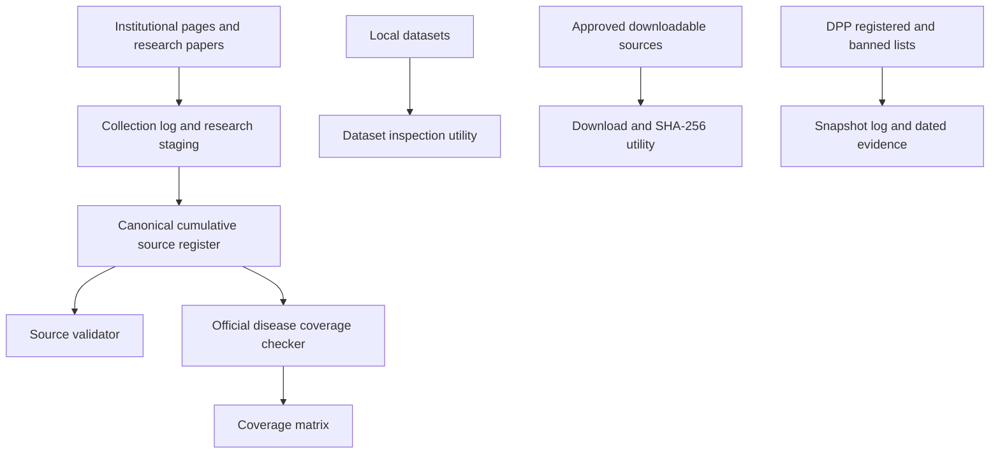

# Week 2 Architecture

## Scope
Week 2 implements source collection, register reconciliation, disease-coverage reporting, and local inspection utilities. The RAG system and agents remain future work.

## Implemented components

| Component | Responsibility | Status |
|---|---|---|
| `source_collection_log.csv` | Captures research leads and access status | Present |
| `week-1/knowledge/source_register.csv` | Canonical cumulative register | 61 records |
| `scripts/check_coverage.py` | Checks coverage against official R1–R6, W1–W6, C1–C6 IDs | Present |
| `reports/disease_source_coverage.csv` | Coverage output | Present |
| `datasets/inspect_datasets.py` | Measures image counts on the local machine | Utility present; not yet run against local data |
| `fetch_and_hash.py` | Downloads approved documents and computes SHA-256 | Utility present; downloads not evidenced |
| `dpp_snapshot_log.csv` | Tracks official DPP list snapshot tasks | Present; snapshots outstanding |

## Data flow

## Planned downstream use
Verified source material may later feed document extraction, disease knowledge cards, hybrid retrieval, evidence verification, and agent workflows. Those components are not implemented by Week 2. The coverage checker must not be interpreted as a clinical or agronomic validation of source claims.
