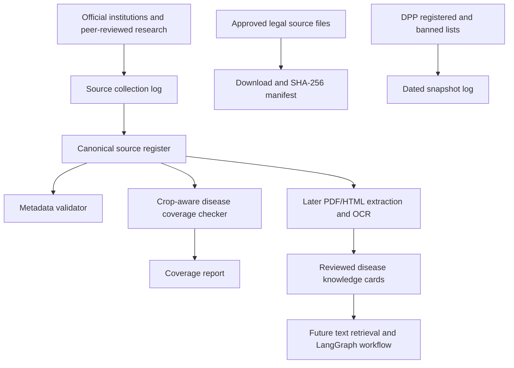

# Week 2 Architecture

## Scope

Week 2 covers agricultural source discovery, source-register reconciliation, disease-to-source coverage, official regulatory evidence tracking and document integrity. The project is text-only. Machine-learning models, image classification, image datasets and image diagnosis are excluded.

## Components

| Component | Responsibility | Status |
|---|---|---|
| `source_collection_log.csv` | Records source discovery and access status | Present |
| `week-1/knowledge/source_register.csv` | Canonical cumulative source register | Present; expanded on deep-verification branch |
| `scripts/check_coverage.py` | Checks crop-aware metadata coverage for R1-R6, W1-W6 and C1-C6 | Present |
| `reports/disease_source_coverage.csv` | Disease-to-source coverage output | Present; regenerate after reconciliation |
| `fetch_and_hash.py` | Downloads only approved sources and computes SHA-256 | Present; download list intentionally empty until access review |
| `dpp_snapshot_log.csv` | Tracks dated official DPP list capture | Present; actual snapshots pending |
| `SHA256SUMS.csv` | Integrity manifest for downloaded source files | Present; empty until files are lawfully downloaded |

## Data flow

## Boundaries

- Coverage metadata is not scientific validation.
- A source is not approved for ingestion until bibliographic accuracy, relevance and access rights are reviewed.
- Chemical claims require current official Pakistan registration and product-label evidence.
- No pesticide dose is inferred or calculated.
- Image and ML workstreams are outside the revised project scope.
